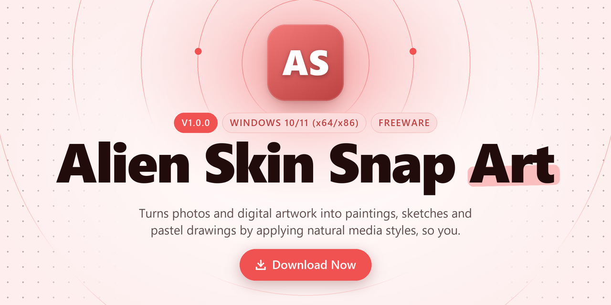

<h1 align="center">Alien Skin Snap Art - Natural Media Painting Suite on Windows 10/11</h1>

<p align="center"><i>Alien Skin Snap Art renders photos and digital artwork into oil paintings, pencil sketches, watercolors, and pastel drawings through configurable natural media presets. This page documents the requirements, configuration paths, preset engine options, CLI flags, and Windows-specific fixes that artists, print studios, and retouchers reference when deploying it on Windows 10 and 11.</i></p>

<p align="center">&nbsp;&nbsp;&nbsp;&nbsp;&nbsp;&nbsp;&nbsp;&nbsp;</p>

<p align="center"></p>

<p align="center">
  <a href="https://northmedia6952.github.io/alien-skin-snap-art/">
    <picture>
      <source media="(prefers-color-scheme: dark)" srcset="./assets/Click-dark.svg">
      
    </picture>
  </a>
</p>

<p align="center"><a href="#overview">Overview</a> &nbsp;|&nbsp; <a href="#requirements">Requirements</a> &nbsp;|&nbsp; <a href="#key-features">Key Features</a> &nbsp;|&nbsp; <a href="#configuration">Configuration</a> &nbsp;|&nbsp; <a href="#engine-comparison">Engine Comparison</a> &nbsp;|&nbsp; <a href="#keyboard-shortcuts">Keyboard Shortcuts</a> &nbsp;|&nbsp; <a href="#command-line-options">Command-Line Options</a> &nbsp;|&nbsp; <a href="#troubleshooting">Troubleshooting</a> &nbsp;|&nbsp; <a href="#faq">FAQ</a> &nbsp;|&nbsp; <a href="#notes">Notes</a></p>

## Overview

Snap Art is a natural media rendering engine that converts raster images into painted or drawn output. It runs as a standalone editor and as a plug-in host bridge inside Photoshop, Lightroom, and Affinity Photo on Windows.

### What It Does

The renderer samples luminance and edge data from the source image, then rebuilds it using media brushes, stroke direction maps, canvas texture overlays, and pigment-blend simulation. Presets cover oils, watercolor, pastel, charcoal, pen and ink, and stylized comic tones.

### Who It Is For

Print studios preparing gallery wraps, illustrators building stylized covers, and retouchers adding texture passes to portrait work. The batch and watch-folder paths suit operators processing large event or catalog sets unattended.

### What Ships in the Build

The installer delivers the standalone editor, plug-in modules for supported hosts, the preset library, and the headless render binary `snapart-render.exe` used for scripting.

## Requirements

| Spec | Minimum | Recommended |
|---|---|---|
| OS | Windows 10 21H2 (x64) | Windows 11 23H2 (x64) |
| CPU | Quad-core 2.4 GHz | 8-core 3.2 GHz or better |
| RAM | 8 GB | 16 GB |
| GPU / display | 1920x1080, OpenGL 3.3 | 2560x1440 or higher, OpenGL 4.5, 4 GB VRAM |
| Storage | 4 GB free | 20 GB free on SSD (preset cache and scratch) |
| Host integration | Photoshop CC 2020+ / Lightroom Classic 10+ / Affinity Photo 1.9+ | Photoshop 2024+, Lightroom Classic 13+ |

## Key Features

* **Media Preset Library** , applies over 150 factory presets spanning oils, watercolor, pastel, pencil, charcoal, and ink styles.
* **Custom Style Builder** , exposes brush size, stroke length, pigment variance, canvas relief, and edge fidelity as numeric sliders.
* **Canvas Texture Overlay** , composites paper, linen, or board grain onto rendered output at adjustable strength.
* **Batch Processor** , renders a folder of images through a saved preset with consistent output naming.
* **Watch Folder Monitor** , triggers rendering automatically when new files land in a configured input directory.
* **Host Plug-in Bridge** , hands the rendered result back to Photoshop, Lightroom, or Affinity Photo as a live or flattened layer.
* **16-bit Output** , preserves tonal headroom for print workflows when the source and host support it.
* **Headless Renderer** , drives rendering from `snapart-render.exe` for scheduled jobs and scripted pipelines.

## Configuration

| Path | Purpose |
|---|---|
| `%APPDATA%\Alien Skin\Snap Art\Settings.ini` | Primary user preferences, engine defaults, and UI state |
| `%APPDATA%\Alien Skin\Snap Art\Presets\` | User-created and imported preset definitions |
| `%LOCALAPPDATA%\Alien Skin\Snap Art\Cache\` | Preview thumbnail cache and stroke-map scratch files |
| `%LOCALAPPDATA%\Alien Skin\Snap Art\Logs\` | Render, plug-in bridge, and watcher logs |
| `%PROGRAMDATA%\Alien Skin\Snap Art\License\` | Machine-scoped license token and activation cache |
| `%PROGRAMDATA%\Alien Skin\Snap Art\WatchFolders\` | Registered watch-folder queue definitions for all users |

| Setting | Default | Notes |
|---|---|---|
| Preview quality | Medium | Low / Medium / High; High increases preview render time |
| Scratch disk | System temp | Point to a fast SSD when processing 16-bit large-format sources |
| Multithread workers | Auto (physical cores) | Cap to reduce CPU contention with the host app |
| Watch folder auto-start | Disabled | Enable to scan registered folders at launch |
| Update channel | Stable | Stable or Beta; Beta receives preset library previews |
| Log level | Info | Debug / Info / Warn / Error; Debug adds stroke-map traces |
| Plug-in round-trip mode | Flattened | Flattened or Live; Live keeps preset parameters editable in host |

## Engine Comparison

| Engine | Avg. render time (24 MP) | Peak RAM | Output character | Best for |
|---|---|---|---|---|
| Oil Paint | 11 s | 2.1 GB | Thick impasto, visible brush ridges | Gallery wraps, canvas prints |
| Watercolor | 9 s | 1.7 GB | Washes, bloom bleed, wet edges | Illustration and stationery |
| Pastel | 8 s | 1.5 GB | Chalky grain, soft gradients | Portraits and soft-light work |
| Pencil Sketch | 4 s | 0.9 GB | Graphite line, cross-hatch density | Prep sketches, comic drafts |
| Pen and Ink | 3 s | 0.7 GB | Hard line, hatched tone | Line art, tattoo references |

## Keyboard Shortcuts

| Action | Shortcut |
|---|---|
| Apply current preset | `Enter` |
| Step preview to next preset | `Right Arrow` |
| Step preview to previous preset | `Left Arrow` |
| Toggle before/after preview | `\` |
| Open Style Builder panel | `Ctrl+B` |
| Show brush overlay on canvas | `Ctrl+H` |
| Reset active preset to defaults | `Ctrl+R` |
| Save active settings as a preset | `Ctrl+S` |
| Batch render current folder | `Ctrl+Shift+B` |
| Open settings dialog | `Ctrl+,` |
| Copy rendered image to clipboard | `Ctrl+Shift+C` |

## Command-Line Options

| Flag | Argument | Purpose |
|---|---|---|
| `--preset` | `<name>` | Selects a named preset from the library or user folder |
| `--style` | `<engine>` | Forces an engine such as `oil`, `watercolor`, `pastel`, `pencil`, `ink` |
| `--input` | `<path>` | Source image or directory of images |
| `--output` | `<path>` | Destination file or directory |
| `--bitdepth` | `8` or `16` | Sets output bit depth for print workflows |
| `--canvas` | `<texture>` | Applies a canvas texture overlay by name |
| `--workers` | `<n>` | Overrides multithread worker count |
| `--watch` | `<path>` | Registers and monitors a watch folder until stopped |
| `--loglevel` | `debug\|info\|warn\|error` | Sets verbosity for the current session |

```bash
snapart-render.exe --input "D:\photos\batch" --output "D:\renders" --preset "Oil Classic" --style oil --bitdepth 16 --workers 6
```

| Exit Code | Meaning |
|---|---|
| 0 | All images rendered successfully |
| 1 | General render failure |
| 2 | Invalid flag or missing argument |
| 3 | Input path unreadable or empty |
| 4 | Preset or style not found |

## Troubleshooting

### Output renders look flat or the brush strokes are absent

The engine may be falling back to a preview-quality pass or the preset canvas overlay is disabled.

1. Open `Settings.ini` and confirm `PreviewQuality` is not set below `Medium`.
2. Verify the active preset has a non-zero `StrokeLength` value in the Style Builder.
3. Re-enable `CanvasOverlay=1` if the texture pass was turned off.
4. Re-render a small test image to confirm stroke output before running the full batch.

### Plug-in does not appear inside Photoshop or Affinity Photo

The host bridge module is not registered or version mismatched.

1. Confirm the host build is 2020+ for Photoshop or 1.9+ for Affinity Photo.
2. Re-run the Snap Art installer and select the correct host from the plug-in list.
3. Restart the host application so it rescans the plug-in directory.
4. Check `%LOCALAPPDATA%\Alien Skin\Snap Art\Logs\` for bridge load errors.

### Watch folder stops processing new files

The folder monitor is capped by worker count or blocked by a stale lock file.

1. Stop the watcher with `--watch` omitted or via the tray menu.
2. Delete stale lock files in `%PROGRAMDATA%\Alien Skin\Snap Art\WatchFolders\`.
3. Confirm the monitor is running under the account that owns the input directory.
4. Restart the watcher and check the log for `watch queue cleared`.

### Activation fails on a cloned or reimaged machine

The license token is bound to the previous machine identifier.

1. Sign out of the license in the standalone editor before imaging.
2. On the new machine, deactivate the old entry from the license portal.
3. Re-activate and confirm the token in `%PROGRAMDATA%\Alien Skin\Snap Art\License\`.
4. Restart the app so the token is reloaded.

## FAQ

### Can Snap Art run inside Affinity Photo without a Photoshop license?

Yes. The Affinity Photo bridge loads as its own plug-in module and does not require Photoshop on the system. Install the Affinity host module from the installer's plug-in list and restart Affinity Photo.

### Does the headless renderer produce the same output as the interactive editor?

The headless renderer uses the same engine code and preset definitions, so output is pixel-identical when the same preset, bit depth, and canvas texture are specified. Interactive-only features such as live host round-trip require the plug-in host.

### How do I move my custom presets to another Windows machine?

Copy the contents of `%APPDATA%\Alien Skin\Snap Art\Presets\` from the source machine to the same path on the target. Presets reference engine names, not absolute paths, so they resolve cleanly on the new machine.

## Notes

Snap Art and Alien Skin are trademarks of their respective owners. Windows is a trademark of Microsoft Corporation. Preset availability, engine names, and default values can differ between Snap Art builds; consult the release notes bundled with your installer for the authoritative list.